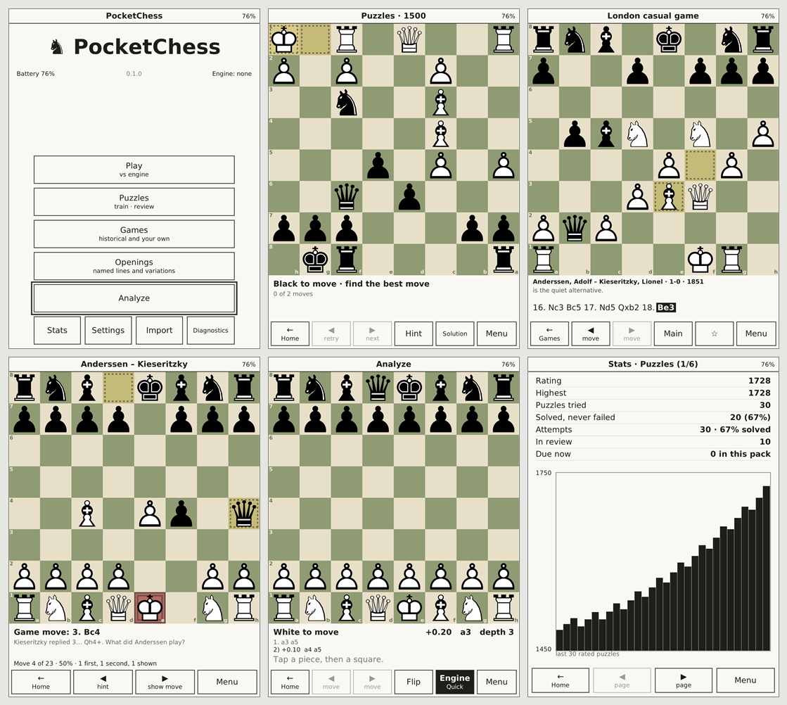

# PocketChess

Offline chess study app for the **PocketBook Verse Pro Color** (PB634K3, firmware 6.10), built in
parallel for **Windows** (native Visual Studio projects with an e-ink simulator) and the reader
(CMake + Ninja + Zig cross-compile). GPL-3.0-or-later.



*Real canvas output of the current build (`pocketchess-headless --screenshot`): the same pixels
the reader receives.*

Status: **M0/M1 preview** — chess core complete and perft-validated, board UI with tap/drag
moves, promotion, variations, FEN entry, mono and color themes, minimal-refresh e-ink pipeline,
Diagnostics spike screen, engine probe, both build harnesses. See
[`docs/project-status.md`](docs/project-status.md) for what works and the resume point, and
[`docs/ai/`](docs/ai/README.md) for the plan.

## First-time setup (Windows)

1. Visual Studio 2026 with the C++ workload (toolset v145) and "C++ CMake tools for Windows".
2. Vendor SDL3 from Enigmistica (one time, no downloads):

   ```powershell
   scripts\vendor-libs.ps1
   ```

3. Optional, for the engine: `scripts\fetch-engines.ps1` (Stockfish 19 sources + NNUE into
   `libs\stockfish\`, local only).

## Build and run

| What | How |
| --- | --- |
| Desktop app | open `projects\msvc\PocketChess.sln`, configuration **Desktop**, F5 |
| Everything (Windows + reader + engines) | configuration **Debug** or **Release**, Build Solution |
| Tests | `PocketChessTests` builds and runs automatically (or `projects\msvc\build.ps1 -Target Test`) |
| Reader build only | `projects\pocketbook\build-zig.ps1 -Configuration Release` |
| Copy to the reader | `projects\pocketbook\deploy.ps1 -Eject` |
| Screenshot without a window | `PocketChessHeadless --screen analyze --script "tap:e2;tap:e4" --screenshot out.png` |
| Milestone gate | `scripts\verify-all.ps1` |

Desktop keys: PgUp/PgDn or ←/→ = Prev/Next, M = Menu, Esc = Back, Enter = OK, right-click = long
press. Simulator: F2 display mode (Exact / Mono 16-gray / Kaleido 3), F3 refresh rectangles,
F4 full-refresh flash, F6 latency emulation, F9 sleep/wake, F5 battery, F12 screenshot,
Ctrl+wheel zoom.

Command line (desktop, headless and device share it): `--profile verse-pro-color|mono-758x1024|...`
`--root <dir>` `--screen home|analyze|diagnostics` `--fen "<fen>"` `--mono` `--theme <name>`
`--script "<cmds>"` `--screenshot <png>` `--timing`.

## Layout

```text
src/core        chess rules (bitboards, FEN, SAN, PGN, UCI, move codec, game tree), engine protocol, util
src/ui          software canvas, TrueType rasterizer, PNG writer, board view, themes, widgets, refresh policy
src/app         application, screens (Home, Analyze, Diagnostics), dialogs, scripting, headless host
src/platform    sdl (desktop + e-ink simulator), pocketbook (InkView), win32/posix (engine processes)
tests           core/ui/app suites, golden images, fake UCI engine
projects        msvc (solution), pocketbook (CMake + Zig), engines.txt, bundle-manifest.txt
scripts         check-sources, verify-all, stage-bundle, vendor-libs, fetch-engines
data            fonts, engine descriptors, simulator parameters
docs            design notes, plan (docs/ai), ADRs, project status
```

Conventions for contributors and coding agents: [`AGENTS.md`](AGENTS.md).
